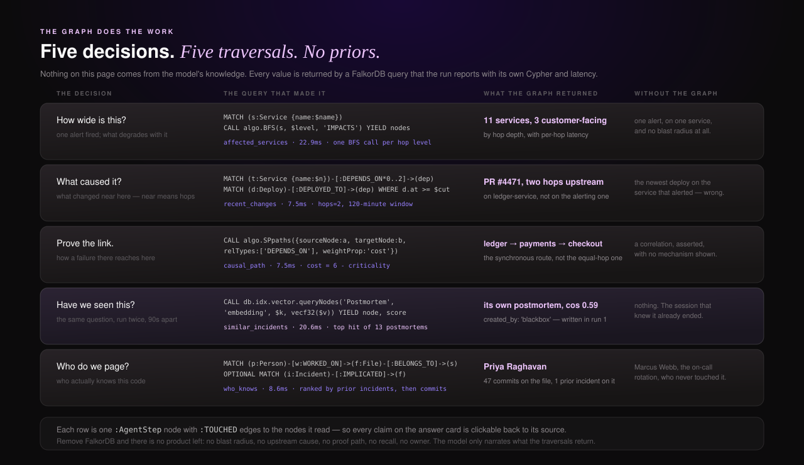

<div align="center">

<a href="https://rohit-ats.github.io/Blackbox/console/">
  
</a>

<br>

[](https://rohit-ats.github.io/Blackbox/console/)
[](https://github.com/Rohit-ATS/Blackbox/releases/download/v1.0.0/BLACKBOX-demo.mp4)
[](https://falkordb.com)


**[Live demo](https://rohit-ats.github.io/Blackbox/console/)** · [Watch the demo](#-watch-it-run) · [Quick start](#-quick-start) · [**The graph**](#-the-graph) · [Where every answer comes from](#-the-graph-does-the-work) · [The two runs](#-the-demo-in-two-runs) · [How it works](#-how-it-works) · [Schema](./schema.md) · [MCP](./mcp/README.md)

</div>


Production breaks. BLACKBOX reads your service graph, maps everything degrading
with it, finds the change that caused it **two hops upstream**, recalls the last
time this happened, pages the human who actually knows — then **writes what it
learned back into the graph**, so the next incident of the same shape resolves in
a fraction of the hops.

> **The graph isn't where the agent looks things up. It's where the agent thinks.**


## ⚖ For judges — the 60-second path

| | | |
|:--|:--|:--|
| 🎥 | **See the agent actually run** | [Demo video, 2:54, 1080p](https://github.com/Rohit-ATS/Blackbox/releases/download/v1.0.0/BLACKBOX-demo.mp4) · [or press *run cold* then *run warm*, live](https://rohit-ats.github.io/Blackbox/console/) |
| 🗺 | **The graph — nodes, edges, queries** | [The graph map](#-the-graph) · [full schema with index definitions](./schema.md) |
| 🛡 | **Where each answer comes from** | [Five decisions, five traversals](#-the-graph-does-the-work) — no claim on the answer card is the model's prior |
| 🧠 | **The part a cache can't fake** | [The agent writes a node in run 1 and retrieves it in run 2](#-the-demo-in-two-runs) — press **forget** and run 2 becomes run 1 again |
| ⚡ | **Run it yourself** | `docker compose up` — [one command, no API key, no auth](#-quick-start) |


## 🎥 Watch it run

<div align="center">

<a href="https://github.com/Rohit-ATS/Blackbox/releases/download/v1.0.0/BLACKBOX-demo.mp4">
  
</a>

</div>

<div align="center">

<video src="https://github.com/Rohit-ATS/Blackbox/releases/download/v1.0.0/BLACKBOX-demo.mp4" controls width="100%"></video>

</div>

<sub>If the inline player doesn't load in your browser,
**[download or stream the MP4 directly](https://github.com/Rohit-ATS/Blackbox/releases/download/v1.0.0/BLACKBOX-demo.mp4)**
(43 MB, 1080p, 2:54) — or skip the video entirely and
[drive the live console](https://rohit-ats.github.io/Blackbox/console/).</sub>

It is screen capture of the product, not slides: the SSE stream arriving, each
tool call naming the traversal it is about to run, the subgraph animating as it
is touched, the answer card assembling with a citation per claim, and then the
same failure signature arriving on a different service and being resolved from
memory.


## ▶ Three ways to see it

<table>
<tr>
<td width="55%" valign="top">

### [rohit-ats.github.io/Blackbox](https://rohit-ats.github.io/Blackbox/console/)

Press **run cold**, then **run warm**.

That page is served as static files, so there is no FalkorDB behind it. It
replays [`fixtures/`](./fixtures) — real runs recorded against a real graph by
`python -m blackbox.record_fixtures`, byte-identical to what the SSE endpoint
streams.

Every step, latency and answer on screen is genuine output; it just happened
earlier. The page says so in a banner.

</td>
<td width="45%" valign="top">

### Want the real thing?

With an agent actually querying FalkorDB, it is **one command** and about two
minutes — see [Quick start](#-quick-start).

```bash
docker compose up
```

That is the version the demo video records: a real agent, real traversals
against a real FalkorDB, real latencies.

</td>
</tr>
</table>


## ⚡ Quick start

**Requires Docker. Nothing else.** No API key, no sign-up, **no auth anywhere**.

```bash
git clone https://github.com/Rohit-ATS/Blackbox
cd Blackbox
cp .env.example .env          # optional: add an Anthropic key
docker compose up
```

Then open **http://localhost:3000**, click **run cold**, then **run warm**.

| | Service | URL |
|:--|:--|:--|
| 🖥 | Landing page + console | <http://localhost:3000> |
| ⚙ | API (OpenAPI docs at `/docs`) | <http://localhost:8000> |
| 🕸 | FalkorDB Browser | <http://localhost:3100> |

`docker compose up` seeds both tenant graphs on first boot. That is the whole setup.

<details>
<summary><b>Running it without Docker</b></summary>

<br>

```bash
docker compose up -d falkordb
cd backend
python -m venv .venv && .venv/bin/pip install -r requirements.txt
python -m blackbox.seed --all
python -m blackbox.run_demo --reset        # the whole demo, in the terminal
uvicorn blackbox.api:app --port 8000
# and in a second terminal
cd frontend && npm install && npm run dev
```

</details>

<details>
<summary><b>About the Anthropic key — the demo works without one</b></summary>

<br>

BLACKBOX has two brains behind one interface:

| Brain | What it is |
|:--|:--|
| **`claude-sonnet-4-6`** | A real tool-calling loop. The model chooses which traversal to run and writes the prose. |
| **The deterministic planner** | A rule-based policy over the same nine tools, used when no key is set. |

Either way, *every finding comes from the graph*, not from the model. The planner
reaches the same root cause by the same tool calls; it just doesn't narrate as
well. Which brain ran is reported in every run and shown in the UI, and a model
failure degrades to the planner mid-run rather than producing an empty answer.
The toolbar lets you force either one.

> The default is the lower-cost `claude-sonnet-4-6`. Override with
> `BLACKBOX_MODEL` if you want to run a different Anthropic model.

</details>


## 🗺 The graph



### The nodes

Thirteen labels, one graph per tenant. The three with a 384-dim `embedding` are
the three the agent searches by meaning rather than by key.

| | Label | What it is | Key properties |
|:--|:--|:--|:--|
| 🧩 | `Service` | a running service | `name, tier, language, repo, revenue_critical, customer_facing` |
| 🚀 | `Deploy` | **a node, not a property** — so you can traverse to it | `sha, at, status, pr_number, risk_score` |
| 🔀 | `PullRequest` | the change itself | `number, title, merged_at, additions, deletions` |
| 📄 | `File` | the unit people actually have expertise in | `path, repo` |
| 👤 | `Person` | an engineer | `name, handle, role, timezone, on_call` |
| 👥 | `Team` | ownership | `name` |
| 🔔 | `Alert` | what fired | `metric, value, threshold, fired_at` |
| 🔥 | `Incident` | **episodic memory** — what happened | `symptom, severity, started_at, embedding(384)` |
| 🧠 | `Postmortem` | **semantic memory** — what it means | `lesson, created_by, embedding(384)` |
| 📕 | `Runbook` | **procedural memory** — what to do | `title, body, embedding(384)` |
| 💬 | `Message` | Slack-style chatter around an incident | `channel, text, author, embedding(384)` |
| 🧱 | `Decision` | an ADR | `title, rationale, at` |
| 🤖 | `AgentStep` | one tool call the agent made | `agent, tool, args, latency_ms, incident_id` |

### The relationships

```cypher
// topology — criticality lives on the edge, because a service is not uniformly critical
(:Service)-[:DEPENDS_ON {criticality, protocol, cost}]->(:Service)
(:Service)-[:IMPACTS    {criticality, protocol, cost}]->(:Service)   // materialised inverse
(:Service)-[:OWNED_BY]->(:Team)

// change — a deploy you can reach from two hops away
(:Deploy)-[:DEPLOYED_TO]->(:Service)      (:Deploy)-[:SHIPS]->(:PullRequest)
(:PullRequest)-[:TOUCHES]->(:File)        (:File)-[:BELONGS_TO]->(:Service)

// people — expertise is commits on files, not a name on a rotation
(:Person)-[:AUTHORED]->(:PullRequest)     (:Person)-[:WORKED_ON {commits, last_at}]->(:File)
(:Person)-[:MEMBER_OF]->(:Team)

// incident + memory
(:Alert)-[:FIRED_ON]->(:Service)          (:Incident)-[:TRIGGERED_BY]->(:Alert)
(:Incident)-[:AFFECTED]->(:Service)       (:Incident)-[:IMPLICATED]->(:File)
(:Postmortem)-[:APPLIES_TO]->(:Service)   (:Runbook)-[:COVERS]->(:Service)
(:Message)-[:ABOUT]->(:Incident)          (:Decision)-[:CONCERNS]->(:Service)
(:Decision)-[:MADE_BY]->(:Person)

// ↓ the three the agent writes at runtime — this is the write-back loop
(:Incident)-[:CAUSED_BY]->(:Deploy)
(:Incident)-[:RESOLVED_BY]->(:Person)
(:Incident)-[:PRODUCED]->(:Postmortem)

// ↓ and the trace: handoff state in the graph instead of in process memory
(:AgentStep)-[:NEXT]->(:AgentStep)        (:AgentStep)-[:TOUCHED]->()   // any node
```

### How the agent queries them

Every row below is a typed tool, not a prompt. The model picks *which* one to
call; it never writes Cypher, and each call returns `{data, path, cypher, latency_ms}`
so the query that produced the answer ships with the answer.

| The agent's question | The traversal | FalkorDB feature |
|:--|:--|:--|
| *which node is this alert even about?* | `db.idx.fulltext.queryNodes('Service', $q)` | fulltext index |
| *what else is breaking?* | `algo.BFS(s, $level, 'IMPACTS')`, one hop level at a time | **graph algorithm** |
| *what changed near here?* | `(:Service)-[:DEPENDS_ON*0..2]->(dep)<-[:DEPLOYED_TO]-(:Deploy)`, time-filtered | variable-length walk + range index |
| *how does a failure there reach here?* | `algo.SPpaths(weightProp:'cost', relTypes:['DEPENDS_ON'])` | **weighted shortest path** |
| *have we seen this before?* | `db.idx.vector.queryNodes('Postmortem','embedding', $k, vecf32($v))` | **vector index** (HNSW, cosine) |
| *who actually knows this code?* | `(:Person)-[:WORKED_ON]->(:File)-[:BELONGS_TO]->(:Service)`, ranked | pattern match + aggregation |
| *what do we do about it?* | fulltext + vector hybrid over `:Runbook` | two indexes, one answer |
| *what does the system lean on?* | `algo.pageRank('Service','DEPENDS_ON')` | **graph algorithm** |
| *remember this.* | `MERGE (pm:Postmortem) SET pm.embedding = vecf32($v)` | write + vector index |

Three modelling decisions carry the whole demo, and
[`schema.md`](./schema.md) argues each one in full: **criticality on the edge**
(so shortest-path can prefer the hard synchronous route), **`IMPACTS` as a
materialised inverse** (so `algo.BFS` can walk dependencies backwards), and
**deploys as first-class nodes** (so "what changed near here" can mean graph
distance rather than the same service).

Read the graph yourself while it runs — the FalkorDB Browser is at
<http://localhost:3100>:

```cypher
// the subgraph the agent built for the cold run, in one query
MATCH (a:AgentStep {incident_id:'INC-3001'})-[:TOUCHED]->(n)
RETURN a.agent, a.tool, a.latency_ms, labels(n), coalesce(n.name, n.id)
ORDER BY a.at;

// everything the agent wrote, and nothing a human did
MATCH (i:Incident)-[:PRODUCED]->(pm:Postmortem {created_by:'blackbox'})
RETURN i.id, pm.id, pm.cause_pr, pm.cause_hops, pm.lesson;
```


## 🔁 The demo, in two runs



### Run 1 — cold

`checkout-api` p99 latency hits 4200ms against a 1500ms threshold, CPU flat.

| # | agent | tool | result | FalkorDB |
|:--|:--|:--|:--|--:|
| 1 | Triage | `resolve_entity` | → `checkout-api` | 5.0ms |
| 2 | Triage | `similar_incidents` | a related prior incident, not conclusive | 19.4ms |
| 3 | Triage | `affected_services` | **11 services degrade with it, 3 customer-facing** | 22.9ms |
| 4 | Triage | `criticality_rank` | PageRank over 42 services | 6.0ms |
| 5 | Investigator | `recent_changes` hops=2 | **PR #4471 on `ledger-service`, 2 hops upstream** | 7.5ms |
| 6 | Investigator | `causal_path` | `ledger-service → payments-api → checkout-api` | 7.5ms |
| 7 | Investigator | `get_runbook` | connection pool exhaustion | 8.7ms |
| 8 | Investigator | `write_finding` | **`CAUSED_BY`** | 4.7ms |
| 9 | Comms | `who_knows` | **Priya Raghavan**, not the rotation default | 8.6ms |
| 10 | Comms | `write_finding` | **`Postmortem`** + embedding | 7.3ms |
| 11 | Comms | `write_finding` | `RESOLVED_BY` | 4.6ms |

11 tool calls · **102.2ms of total measured graph work**, of which
**61.2ms is investigation work** — the traversals that memory can actually
eliminate, i.e. everything except the entity lookup, the memory lookup and the
write-back, which both runs pay for. Every figure here is read straight out of
[`fixtures/cold_run.json`](./fixtures/cold_run.json).

Two details worth noticing. **The cause is not on the service that alerted** — it
is two hops upstream, and at `hops=1` the query misses it entirely. And the
person to page wrote the file 47 times and resolved a prior incident on it; the
rotation would have paged someone else.

### Run 2 — warm

A different service, `notifications-api`, with the same failure signature. The
first memory lookup now returns **the postmortem BLACKBOX wrote 90 seconds ago**
(cosine similarity 0.59), so the mechanism and the fix are already known:

- the whole upstream search, the shortest-path proof and the runbook fetch
  collapse into **one single-hop lookup**
- Triage skips the depth-4 traversal and PageRank entirely
- **11 tool calls → 7**, **61.2ms → 12.9ms of investigation work**, investigation
  steps **4 → 2**. The shared entity lookup, vector recall, and write-back are
  shown separately from the traversal work they do not eliminate.

| # | agent | tool | result | FalkorDB |
|:--|:--|:--|:--|--:|
| 1 | Triage | `resolve_entity` | → `notifications-api` | 3.8ms |
| 2 | Triage | `similar_incidents` | **`PM-INC-3001-BB`, `created_by: 'blackbox'`, cos 0.59** | 20.6ms |
| 3 | Investigator | `recent_changes` hops=1 | PR #4525, same `src/db/pool.ts` signature | 6.4ms |
| 4 | Investigator | `write_finding` | `CAUSED_BY` | 4.1ms |
| 5 | Comms | `who_knows` | **Mei Tanaka** | 6.5ms |
| 6 | Comms | `write_finding` | `Postmortem` + embedding | 6.5ms |
| 7 | Comms | `write_finding` | `RESOLVED_BY` | 4.3ms |

Four tools never get called: `affected_services`, `criticality_rank`,
`causal_path`, `get_runbook`. Their answers were already in the node the agent
wrote 90 seconds earlier — the cause PR, the hop count, the blast radius and the
fix are all properties on that postmortem, so the depth-4 BFS, the PageRank, the
shortest-path proof and the runbook fetch have nothing left to establish.
Numbers from [`fixtures/warm_run.json`](./fixtures/warm_run.json).

Press **forget** in the toolbar — it deletes only the postmortems BLACKBOX wrote,
keeping the seeded history — and the warm run becomes a cold one again. That is
the demonstration: **nothing is cached**, the speed-up is a node that exists
because the agent put it there.

<details>
<summary><b>On the numbers — what is measured, and what could not be verified</b></summary>

<br>

The build plan projected 41s → 8s. That gap is **model latency**: with a key set,
the cold run makes more model turns than the warm one and the wall clock
separates accordingly. On the deterministic planner the entire run is ~250ms end
to end, so wall-clock ratios are noise-dominated and the honest metrics are the
ones above — tool calls, investigation steps, and measured graph time. The UI
reports the total graph time and the investigation-work comparison, all labeled
`measured`.

**The LLM path could not be verified in the build environment** (the available
credential was a Claude Code session token, not an API key, and the Messages API
returned 401), so the quoted numbers throughout this README are all from the
deterministic planner.

The **playback speed** control paces how fast steps are *drawn*. The agent always
runs at full speed on its own thread and every reported number is measured there,
before pacing.

</details>


## 🛡 The graph does the work



Every number on the answer card is a value FalkorDB returned. The model's job is
to choose the next traversal and write the sentence around the result — it is
never the source of a fact. The honest test of that is subtraction: **take
FalkorDB out and there is no product left.**

| Remove this | And the agent loses |
|:--|:--|
| `IMPACTS` edges + `algo.BFS` | the blast radius. One alert on one service, and no idea that 3 customer-facing services are already degraded. |
| `:Deploy` as a traversable node | the cause. The change is two hops upstream on a service that never alerted; at `hops=1` the query returns nothing — [asserted in the test suite](#-tests). |
| `cost` on the edge + `algo.SPpaths` | the proof. There are two two-hop routes to `ledger-service`; only the one through `payments-api` is a hard synchronous call. |
| the vector index on `:Postmortem` | the memory. Run 2 becomes run 1 again — which you can do on demand by pressing **forget**. |
| `WORKED_ON` → `BELONGS_TO` | the right human. It pages Marcus Webb off the rotation instead of Priya Raghavan, who wrote that file 47 times and resolved the last incident on it. |
| `:AgentStep`/`:NEXT`/`:TOUCHED` | the provenance. The trace becomes a log tail, and no claim is clickable back to its source nodes. |

And the claim is auditable, not just stated — ask the API for the subgraph the
run actually built:

```bash
curl -s "http://localhost:8000/api/trace?incident_id=INC-3001" | jq '.steps[] | {agent, tool, latency_ms, touched}'
```

Each step on screen carries the Cypher it ran and the node ids it touched, so a
judge can take any sentence on the answer card and walk it back to the rows that
produced it.


## 🏗 How it works



### Nine typed tools. The model never writes Cypher.



Text-to-Cypher demos beautifully right up until it doesn't, and when it fails you
can't tell whether the model was wrong or the data was. So the graph is exposed as
typed tools instead — traversals and FalkorDB's own algorithms, called as
functions. Every one returns `{data, path, cypher, latency_ms}`: `path` is the
subgraph it touched, which is what the UI animates and what makes each claim on
the answer card clickable back to its source nodes.

| tool | mechanism | what it answers |
|:--|:--|:--|
| `resolve_entity` | fulltext | an alert string becomes a node |
| `affected_services` | `algo.BFS` over the materialised inverse | who degrades with it, by hop depth |
| `recent_changes` | variable-length walk, time-filtered | what changed up to N hops upstream |
| `causal_path` | `algo.SPpaths`, criticality-weighted | how a failure there reaches here |
| `similar_incidents` | vector (HNSW, cosine) | have we seen this before |
| `who_knows` | `WORKED_ON` → `BELONGS_TO`, ranked | who actually knows this code |
| `get_runbook` | fulltext + vector hybrid | the operational fix |
| `criticality_rank` | `algo.pageRank` | what the system structurally leans on |
| **`write_finding`** | `MERGE` + `vecf32` | **the write-back loop** |

### Three agents that hand off through the graph

Triage → Investigator → Comms, with distinct system prompts and distinct tool
subsets. The part that matters: **handoff state is written to FalkorDB, not passed
in process memory.** Every tool call becomes an `:AgentStep` node chained with
`:NEXT`, carrying `:TOUCHED` edges to whatever it looked at.

The trace panel is therefore a Cypher query, not a log tail — and it is the reason
a restarted agent could resume, because the state was never in the process to
begin with. You can read it back yourself:

```bash
curl "http://localhost:8000/api/trace?incident_id=INC-3001" | jq
```

### Memory is data, not a session



Three kinds, all nodes: **episodic** (`Incident` — what happened), **semantic**
(`Postmortem` — what it means, with a 384-dim embedding), and **procedural**
(`Runbook` — what to do). A postmortem BLACKBOX wrote is indistinguishable in kind
from one a human wrote: same label, same vector index, same retrieval path. Only
`created_by` differs. That is why the write in run 1 is retrievable in run 2
without any special casing.

### One instance, isolated graphs

`tenant:acme` and `tenant:globex` are separate graphs on the same FalkorDB
(`db.select_graph(f"tenant:{id}")`). A query against one cannot see the other —
asserted in the tests, and visible in the console's tenant switcher, which swaps a
42-service e-commerce company for a 16-service freight company.


## 🏁 Which track and why

| Track | How BLACKBOX answers it |
|:--|:--|
| **01 — Agents that act on connected data** | Impact `algo.BFS`, criticality-weighted `algo.SPpaths`, `algo.pageRank` — called as agent tools, not reimplemented. Nine typed tools, each returning the query it ran and its latency. Exposed over **MCP** so tool selection can be driven from any MCP client. |
| **02 — Memory and coordination** | Three agents with separate prompts and tool subsets, handing off through `:AgentStep`/`:NEXT` nodes rather than process memory. Episodic, semantic and procedural memory as graph data. The write-back loop is measured on screen: run 2 cites the postmortem run 1 wrote. |
| **03 — The company brain** | Services, deploys, PRs, files, people, teams, runbooks, Slack-style messages and ADRs in one graph with ownership and provenance. Every claim on the answer card carries a citation that highlights its source nodes. |


## 🔌 Drive it from your own Claude

The same nine tools over MCP stdio — see [`mcp/README.md`](./mcp/README.md).

```json
{
  "mcpServers": {
    "blackbox": {
      "command": "python",
      "args": ["/absolute/path/to/Blackbox/mcp/server.py"],
      "env": { "FALKOR_HOST": "localhost", "FALKOR_PORT": "6379" }
    }
  }
}
```

Then ask it *"what breaks if checkout-api goes down?"* or *"something deployed in
the last two hours broke checkout-api — what was it?"*


## ✅ Tests

```bash
cd backend && python -m pytest -q      # 29 passed
```

The suite asserts the demo, not just the plumbing — that the impact traversal
returns exactly 11 services with 3 customer-facing, that the criticality-weighted
path prefers `payments-api` over the equal-hop-count alternative, that
`recent_changes` **misses** the cause at one hop and finds it at two, that the
warm run cites a postmortem whose `created_by` is `blackbox`, and that the tenants
cannot see each other.

## 📂 Layout

```
backend/blackbox/
  topology.py     hand-authored service graph (see schema.md for why)
  seed.py         deterministic generator, both tenants
  schema.py       range + fulltext + vector indexes
  tools.py        the nine tools — this is the product
  agents.py       three agents, the SSE event contract, provenance writes
  llm.py          Anthropic tool-use loop + deterministic planner
  scenarios.py    the two replayable incidents
  api.py          FastAPI, SSE streaming
frontend/         Next.js 14, landing page + console
mcp/              MCP stdio server (same nine tools)
fixtures/         recorded runs, so the UI can be worked on offline
```

## 🧱 Stack

FalkorDB · Python 3.11 · FastAPI · falkordb-py · Anthropic SDK · MCP SDK v2 ·
Next.js 14 · Cytoscape.js · Tailwind

Embeddings are a deterministic local hashed-lexical embedder (384-dim, L2
normalised, no network call, identical on every machine) so the demo is
reproducible. `BLACKBOX_EMBEDDER=minilm` switches to `all-MiniLM-L6-v2` if
`sentence-transformers` is installed — same 384 dimensions, so the vector indexes
don't change.


## 🔍 The queries and algorithms

Every graph call the product depends on lives in one file —
[`backend/blackbox/tools.py`](./backend/blackbox/tools.py) — and each one returns the exact
Cypher it ran in its `cypher` field, so you can read any query straight off the console or
out of the API response. The node and relationship model, the three non-obvious modelling
decisions, and the index definitions are in [`schema.md`](./schema.md).

FalkorDB algorithms used: `algo.BFS` (impact), `algo.SPpaths` (criticality-weighted causal
path), `algo.pageRank` (structural criticality), plus vector (HNSW/cosine), fulltext, and
range indexes.

## 🤖 AI assistance — disclosure

This project was built with **Claude Code** as a coding assistant: it contributed code,
tests, the README and the demo video's motion graphics. Every design decision — the graph
model, the nine-tool boundary, the write-back loop, the handoff-through-the-graph
architecture — was directed and reviewed by me, and I can explain any query, traversal or
architectural choice in the repo. The demo video's narration is AI-synthesized speech.


<div align="center">


**MIT** · Built by **Rohit Maruri** ([@Rohit-ATS](https://github.com/Rohit-ATS)) for Graph Hacks

<sub><i>The graph isn't where the agent looks things up. It's where the agent thinks.</i></sub>

</div>
